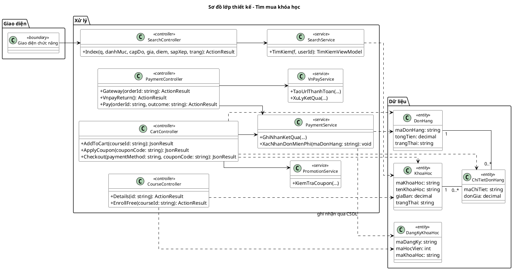
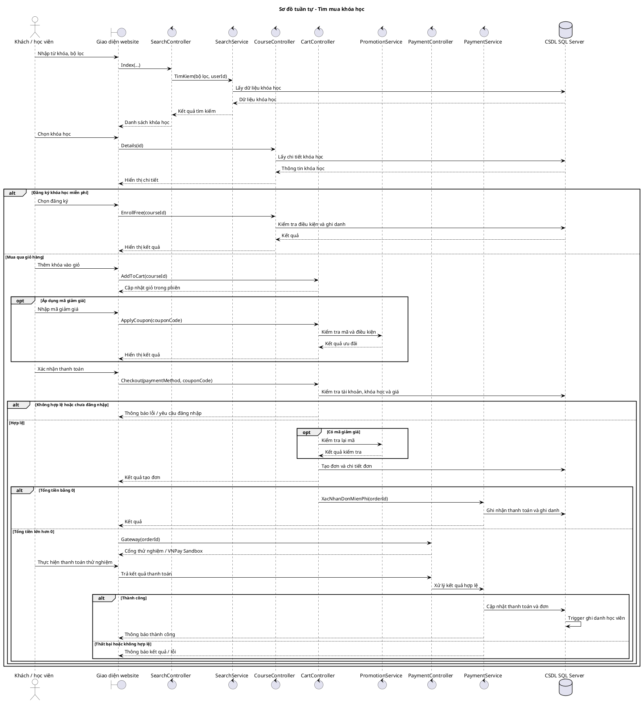
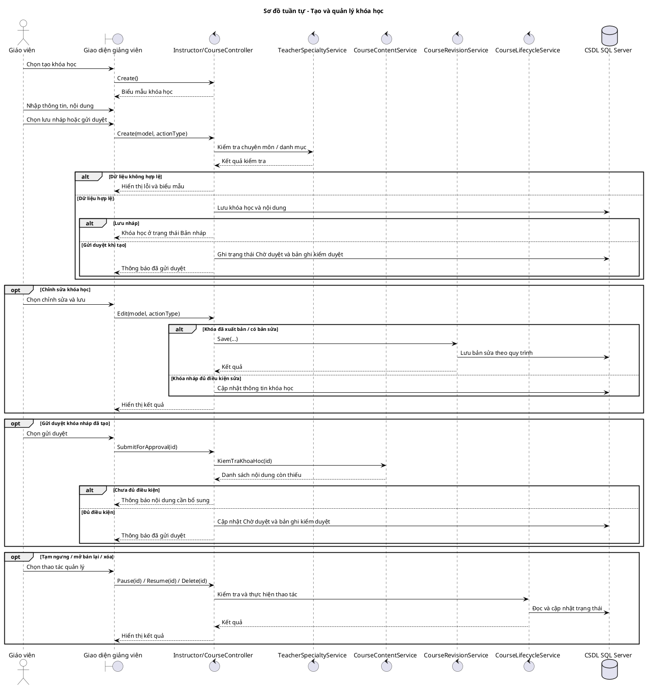
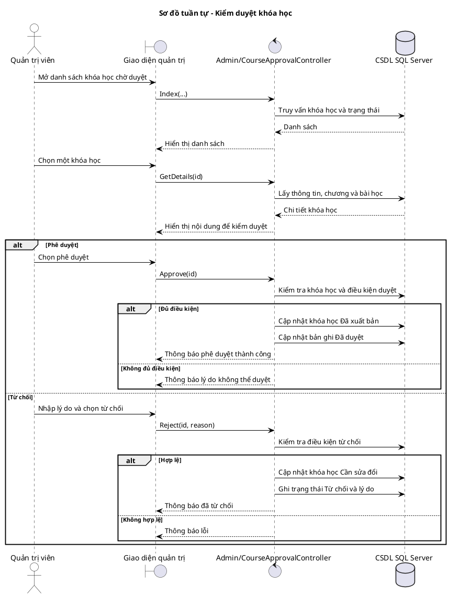

# 4.4. Thiết kế chức năng hệ thống

Các sơ đồ dưới đây mô tả luồng chính trên website ASP.NET MVC. Sao chép từng khối vào PlantUML để xuất hình. Tên phương thức trong sơ đồ lớp là các phương thức tiêu biểu; thông điệp mô tả nghiệp vụ được ghi bằng tiếng Việt không nhất thiết là tên hàm trong mã nguồn. `CSDL` là đối tượng thể hiện SQL Server và Entity Framework để sơ đồ dễ đọc.

## 4.4.1. Thiết kế chức năng tìm mua khóa học

### Sơ đồ lớp mức thiết kế



### Sơ đồ tuần tự chức năng hệ thống



## 4.4.2. Thiết kế chức năng tạo và quản lý khóa học

### Sơ đồ lớp mức thiết kế

```plantuml
@startuml
title Sơ đồ lớp thiết kế - Tạo và quản lý khóa học
left to right direction
skinparam backgroundColor white
skinparam shadowing false
skinparam defaultFontName Arial
skinparam classAttributeIconSize 0
skinparam linetype ortho
skinparam nodesep 35
skinparam ranksep 55
skinparam class {
  BackgroundColor white
  BorderColor black
  ArrowColor black
  FontSize 12
}
package "Giao diện" {
  class "Giao diện chức năng" as BoundaryUI <<boundary>>
}
package "Xử lý" {
  class InstructorCourseController as IC <<controller>> {
    +Index(search, status): ActionResult
    +Create(model, actionType): ActionResult
    +Edit(model, actionType): ActionResult
    +SubmitForApproval(id: string): ActionResult
    +Pause(id: string): ActionResult
    +Resume(id: string): ActionResult
    +Delete(id: string): ActionResult
  }
  class CourseContentService <<service>> {
    +KiemTraKhoaHoc(maKhoaHoc)
  }
  class CourseRevisionService <<service>> {
    +Get(courseId)
    +Save(...)
  }
  class CourseLifecycleService <<service>> {
    +TamNgung(maKhoaHoc, maGiaoVien)
    +MoBanLai(maKhoaHoc, maGiaoVien)
    +Xoa(maKhoaHoc, maGiaoVien)
  }
  class TeacherSpecialtyService <<service>> {
    +Require(...)
  }
}
package "Dữ liệu" {
  class KhoaHoc <<entity>> {
    maKhoaHoc: string
    tenKhoaHoc: string
    maGiaoVien: int
    trangThai: string
  }
  class ChuongHoc <<entity>> {
    maChuong: string
    tenChuong: string
    maKhoaHoc: string
  }
  class BaiHoc <<entity>> {
    maBaiHoc: string
    tenBaiHoc: string
    maChuong: string
  }
  class KiemDuyetKhoaHoc <<entity>> {
    maKiemDuyet: string
    maKhoaHoc: string
    trangThai: string
  }
}
BoundaryUI --> IC
IC --> TeacherSpecialtyService
IC --> CourseContentService
IC --> CourseRevisionService
IC --> CourseLifecycleService
IC ..> KhoaHoc
IC ..> KiemDuyetKhoaHoc
CourseContentService ..> ChuongHoc
CourseContentService ..> BaiHoc
KhoaHoc "1" -- "0..*" ChuongHoc
ChuongHoc "1" -- "0..*" BaiHoc
KhoaHoc "1" -- "0..*" KiemDuyetKhoaHoc
@enduml
```

### Sơ đồ tuần tự chức năng hệ thống



## 4.4.3. Thiết kế chức năng kiểm duyệt khóa học

### Sơ đồ lớp mức thiết kế

```plantuml
@startuml
title Sơ đồ lớp thiết kế - Kiểm duyệt khóa học
left to right direction
skinparam backgroundColor white
skinparam shadowing false
skinparam defaultFontName Arial
skinparam classAttributeIconSize 0
skinparam linetype ortho
skinparam nodesep 35
skinparam ranksep 55
skinparam class {
  BackgroundColor white
  BorderColor black
  ArrowColor black
  FontSize 12
}
package "Giao diện" {
  class "Giao diện chức năng" as BoundaryUI <<boundary>>
}
package "Xử lý" {
  class AdminCourseApprovalController as AC <<controller>> {
    +Index(...): ActionResult
    +GetDetails(id: string): ActionResult
    +Approve(id: string): ActionResult
    +Reject(id: string, reason: string): ActionResult
  }
  class CourseRevisionService <<service>> {
    +Published(trangThai): bool
  }
}
package "Dữ liệu" {
  class KhoaHoc <<entity>> {
    maKhoaHoc: string
    tenKhoaHoc: string
    trangThai: string
    maGiaoVien: int
  }
  class KiemDuyetKhoaHoc <<entity>> {
    maKiemDuyet: string
    ngayGui: DateTime?
    ngayKiemDuyet: DateTime?
    trangThai: string
    lyDoTuChoi: string
    maAdmin: int?
  }
  class NguoiDung <<entity>> {
    maNguoiDung: int
    hoTen: string
    vaiTro: string
    trangThai: bool?
  }
  class ChuongHoc <<entity>>
  class BaiHoc <<entity>>
}
BoundaryUI --> AC
AC ..> CourseRevisionService
AC ..> KhoaHoc
AC ..> KiemDuyetKhoaHoc
AC ..> NguoiDung
AC ..> ChuongHoc
AC ..> BaiHoc
KhoaHoc "1" -- "0..*" KiemDuyetKhoaHoc
NguoiDung "0..1" -- "0..*" KiemDuyetKhoaHoc : người kiểm duyệt
KhoaHoc "1" -- "0..*" ChuongHoc
ChuongHoc "1" -- "0..*" BaiHoc
@enduml
```

### Sơ đồ tuần tự chức năng hệ thống



Sơ đồ trên tập trung luồng duyệt xuất bản khóa học mới. Bản sửa của khóa học đã xuất bản có quy trình riêng (`CourseRevisionService` và `CourseRevisionController`); cần bổ sung sơ đồ riêng nếu báo cáo trình bày chi tiết nghiệp vụ đó.

## 4.5. Kết chương 4

Chương 4 đã trình bày thiết kế các thành phần và chức năng chính của hệ thống ECOLearning dựa trên kết quả phân tích ở chương trước. Các sơ đồ lớp mức thiết kế thể hiện những controller, service và lớp dữ liệu tham gia xử lý; các sơ đồ tuần tự mô tả sự tương tác giữa người dùng, giao diện, các thành phần xử lý và cơ sở dữ liệu trong từng luồng nghiệp vụ.

Ba chức năng được trình bày gồm tìm mua khóa học, tạo và quản lý khóa học, kiểm duyệt khóa học. Thiết kế này là cơ sở để triển khai, kiểm thử và đánh giá hoạt động của hệ thống trong chương tiếp theo.
