# Mã PlantUML bổ sung cho các chức năng chính

Ba chức năng tìm mua, tạo và quản lý khóa học, kiểm duyệt khóa học xem trong [tệp trước](chuong_4_4_plantuml.md). Tệp này bổ sung các nhóm chức năng chính còn lại. Mỗi khối là một sơ đồ độc lập; sao chép từ `@startuml` đến `@enduml`. Sơ đồ biểu diễn luồng điển hình trên website, không bao gồm mọi màn hình và nhánh ngoại lệ. Tên có tiền tố Instructor/Admin phân biệt controller trùng tên trong các Area; đây là tên hiển thị. Các thông điệp nghiệp vụ là mô tả khái quát, không phải tên hàm. Lược bớt tham số, kiểu trả về và các lớp để hình dễ đọc. Kiểm tra lại từng nhánh trước khi đưa vào báo cáo.

## 4.4.4. Đăng ký tài khoản

### Sơ đồ lớp mức thiết kế

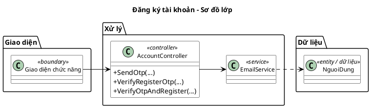

### Sơ đồ tuần tự chức năng hệ thống

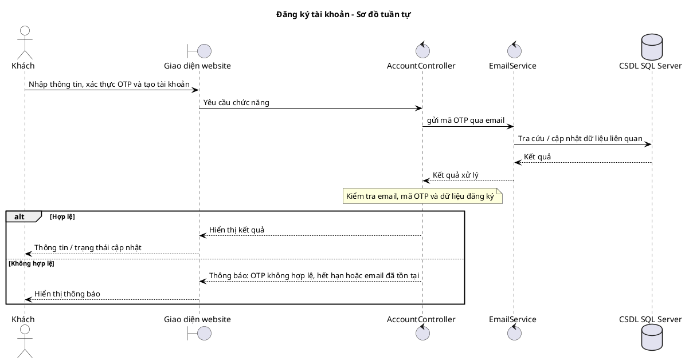

## 4.4.5. Đăng nhập và đăng xuất

### Sơ đồ lớp mức thiết kế

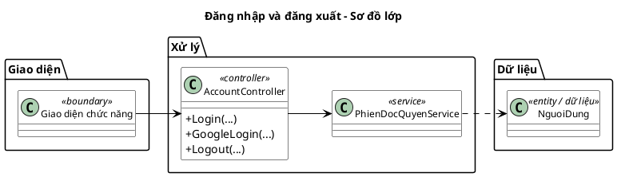

### Sơ đồ tuần tự chức năng hệ thống

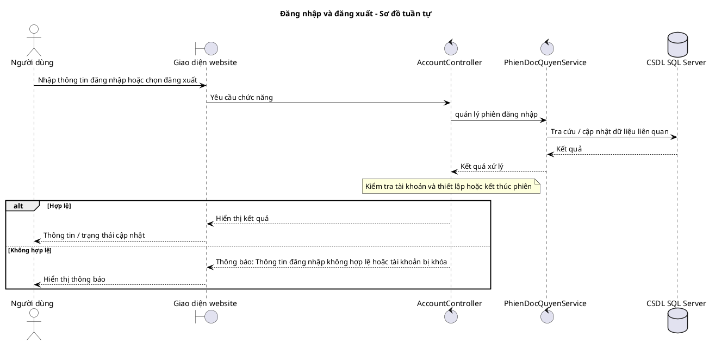

## 4.4.6. Quản lý hồ sơ cá nhân

### Sơ đồ lớp mức thiết kế

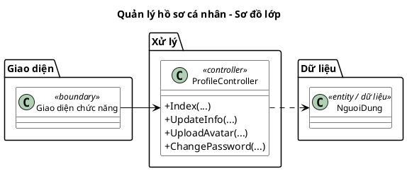

### Sơ đồ tuần tự chức năng hệ thống

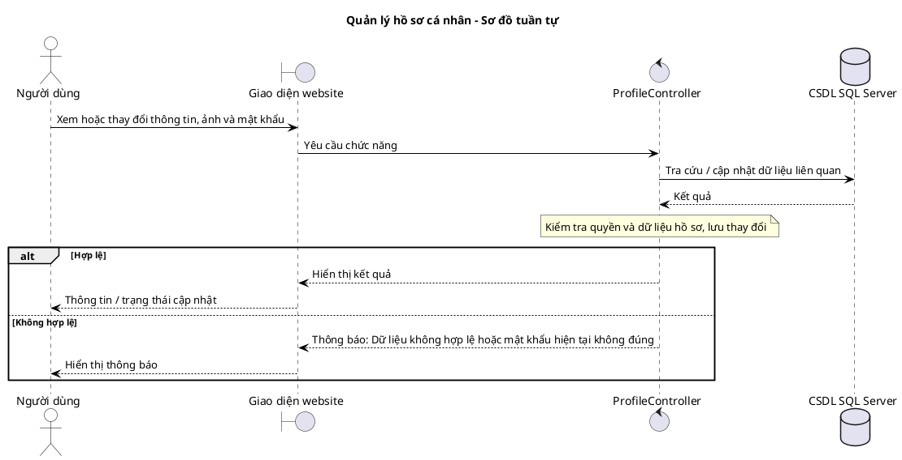

## 4.4.7. Khuyến nghị khóa học

### Sơ đồ lớp mức thiết kế

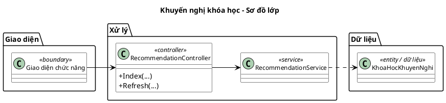

### Sơ đồ tuần tự chức năng hệ thống

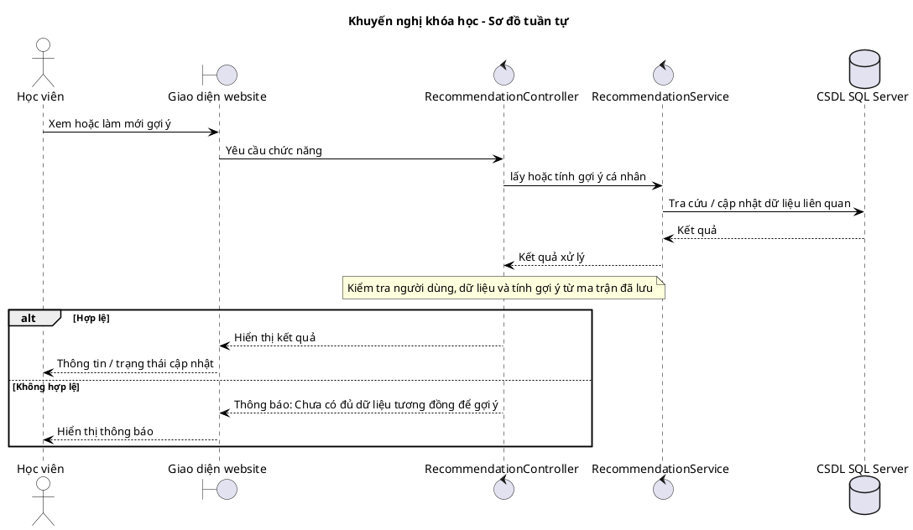

## 4.4.8. Yêu thích khóa học

### Sơ đồ lớp mức thiết kế

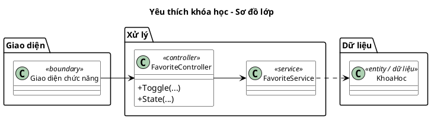

### Sơ đồ tuần tự chức năng hệ thống

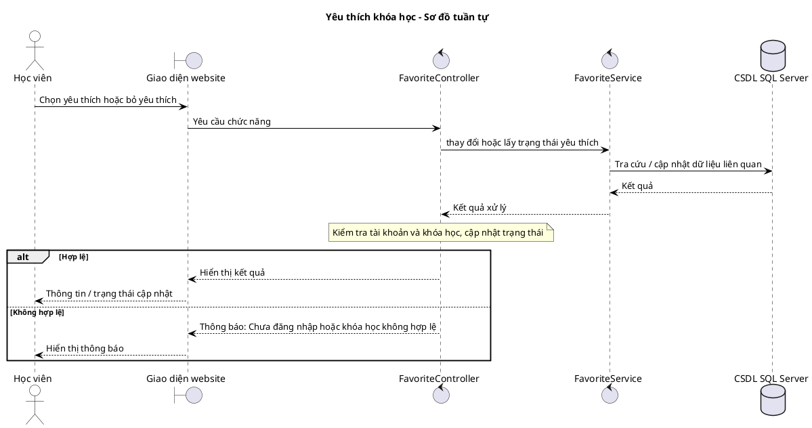

## 4.4.9. Học bài và theo dõi tiến độ

### Sơ đồ lớp mức thiết kế

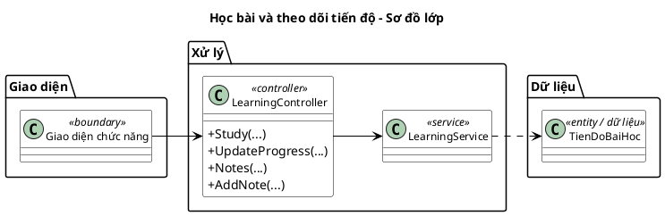

### Sơ đồ tuần tự chức năng hệ thống

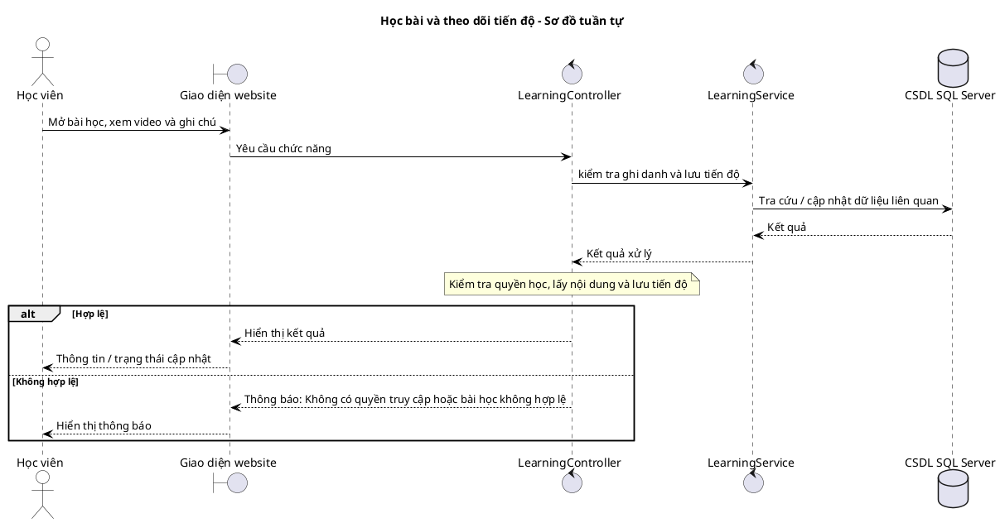

## 4.4.10. Thảo luận bài học

### Sơ đồ lớp mức thiết kế

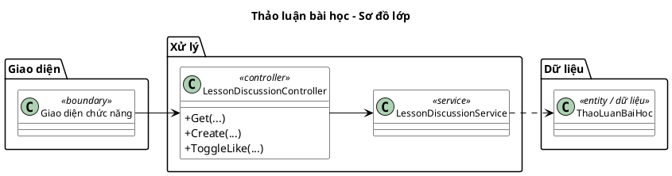

### Sơ đồ tuần tự chức năng hệ thống

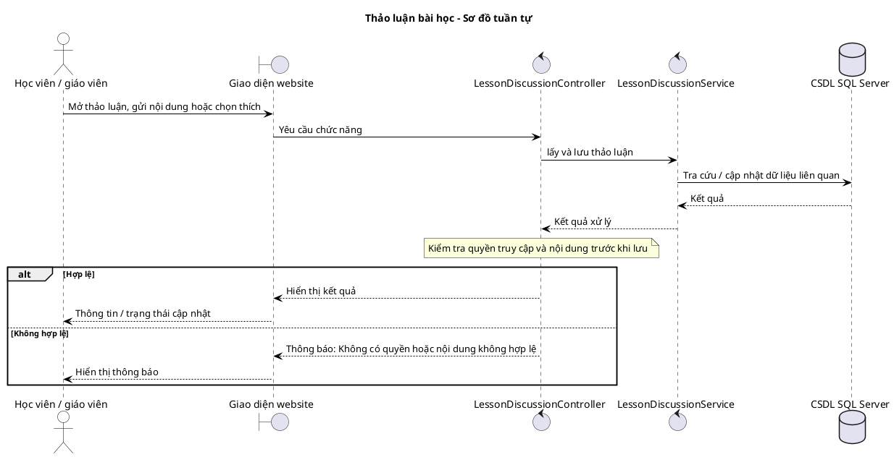

## 4.4.11. Làm bài kiểm tra và nhận chứng chỉ

### Sơ đồ lớp mức thiết kế

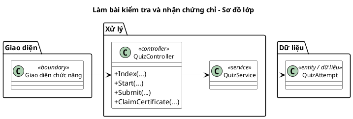

### Sơ đồ tuần tự chức năng hệ thống

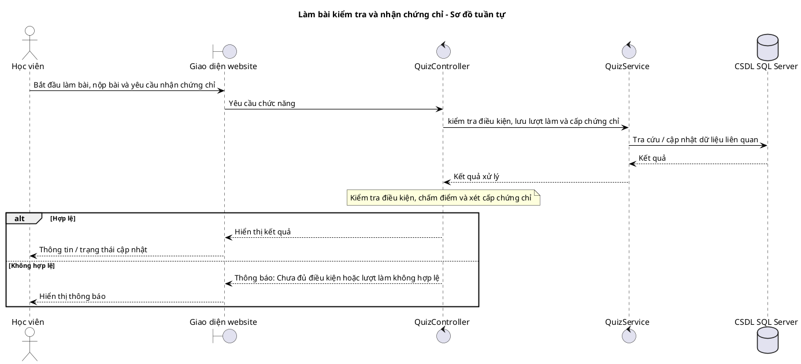

## 4.4.12. Đánh giá khóa học

### Sơ đồ lớp mức thiết kế

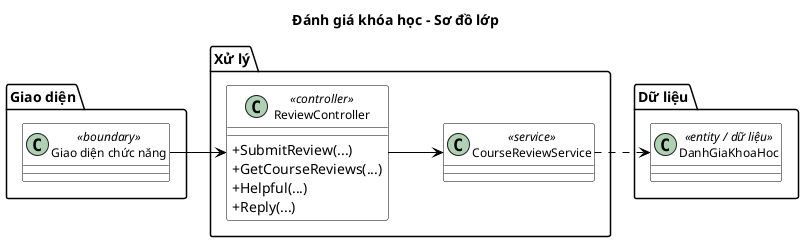

### Sơ đồ tuần tự chức năng hệ thống

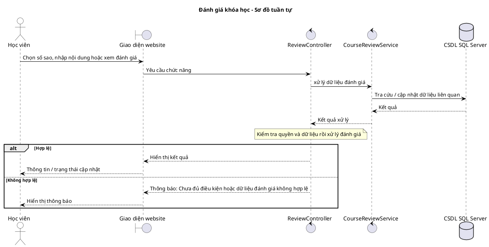

## 4.4.13. Giáo viên quản lý bài kiểm tra

### Sơ đồ lớp mức thiết kế

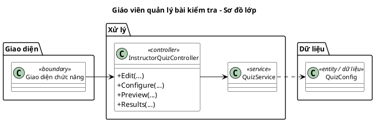

### Sơ đồ tuần tự chức năng hệ thống

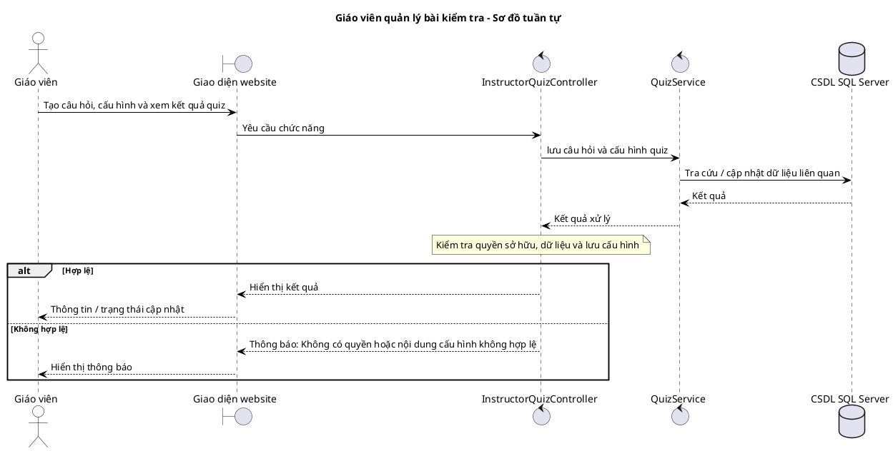

## 4.4.14. Giáo viên yêu cầu nhận doanh thu

### Sơ đồ lớp mức thiết kế

```plantuml
@startuml
title Giáo viên yêu cầu nhận doanh thu - Sơ đồ lớp
left to right direction
skinparam backgroundColor white
skinparam shadowing false
skinparam defaultFontName Arial
skinparam classAttributeIconSize 0
skinparam linetype ortho
skinparam nodesep 35
skinparam ranksep 55
skinparam class {
  BackgroundColor white
  BorderColor black
  ArrowColor black
  FontSize 12
}
package "Giao diện" {
  class "Giao diện chức năng" as BoundaryUI <<boundary>>
}
package "Xử lý" {
  class "PayoutController" as C <<controller>> {
    +Index(...)
    +UpdatePaymentInfo(...)
    +RequestPayout(...)
  }
}
package "Dữ liệu" {
  class "NhanThanhToan" as E <<entity / dữ liệu>>
}
BoundaryUI --> C
C ..> E
@enduml
```

### Sơ đồ tuần tự chức năng hệ thống

```plantuml
@startuml
skinparam backgroundColor white
skinparam shadowing false
skinparam defaultFontName Arial
skinparam sequence {
  ArrowColor black
  LifeLineBorderColor black
  ParticipantBorderColor black
  ParticipantBackgroundColor white
  ActorBorderColor black
  ActorBackgroundColor white
}
title Giáo viên yêu cầu nhận doanh thu - Sơ đồ tuần tự
actor "Giáo viên" as A
boundary "Giao diện website" as UI
control "PayoutController" as C
database "CSDL SQL Server" as DB
A -> UI: Xem số dư, cập nhật tài khoản và gửi yêu cầu
UI -> C: Yêu cầu chức năng
C -> DB: Tra cứu / cập nhật dữ liệu liên quan
DB --> C: Kết quả
note over C: Kiểm tra thông tin, số tiền và tạo yêu cầu chi trả
alt Hợp lệ
  C --> UI: Hiển thị kết quả
  UI --> A: Thông tin / trạng thái cập nhật
else Không hợp lệ
  C --> UI: Thông báo: Thông tin nhận tiền hoặc số tiền không hợp lệ
  UI --> A: Hiển thị thông báo
end
@enduml
```

## 4.4.15. Quản trị viên xử lý yêu cầu chi trả

### Sơ đồ lớp mức thiết kế

```plantuml
@startuml
title Quản trị viên xử lý yêu cầu chi trả - Sơ đồ lớp
left to right direction
skinparam backgroundColor white
skinparam shadowing false
skinparam defaultFontName Arial
skinparam classAttributeIconSize 0
skinparam linetype ortho
skinparam nodesep 35
skinparam ranksep 55
skinparam class {
  BackgroundColor white
  BorderColor black
  ArrowColor black
  FontSize 12
}
package "Giao diện" {
  class "Giao diện chức năng" as BoundaryUI <<boundary>>
}
package "Xử lý" {
  class "PayoutRequestController" as C <<controller>> {
    +Index(...)
    +Approve(...)
    +Reject(...)
  }
}
package "Dữ liệu" {
  class "NhanThanhToan" as E <<entity / dữ liệu>>
}
BoundaryUI --> C
C ..> E
@enduml
```

### Sơ đồ tuần tự chức năng hệ thống

```plantuml
@startuml
skinparam backgroundColor white
skinparam shadowing false
skinparam defaultFontName Arial
skinparam sequence {
  ArrowColor black
  LifeLineBorderColor black
  ParticipantBorderColor black
  ParticipantBackgroundColor white
  ActorBorderColor black
  ActorBackgroundColor white
}
title Quản trị viên xử lý yêu cầu chi trả - Sơ đồ tuần tự
actor "Quản trị viên" as A
boundary "Giao diện website" as UI
control "PayoutRequestController" as C
database "CSDL SQL Server" as DB
A -> UI: Xem và duyệt hoặc từ chối yêu cầu chi trả
UI -> C: Yêu cầu chức năng
C -> DB: Tra cứu / cập nhật dữ liệu liên quan
DB --> C: Kết quả
note over C: Kiểm tra trạng thái, ghi nhận kết quả thử nghiệm hoặc lý do
alt Hợp lệ
  C --> UI: Hiển thị kết quả
  UI --> A: Thông tin / trạng thái cập nhật
else Không hợp lệ
  C --> UI: Thông báo: Yêu cầu không hợp lệ hoặc đã được xử lý
  UI --> A: Hiển thị thông báo
end
@enduml
```

## 4.4.16. Duyệt đăng ký giáo viên

### Sơ đồ lớp mức thiết kế

```plantuml
@startuml
title Duyệt đăng ký giáo viên - Sơ đồ lớp
left to right direction
skinparam backgroundColor white
skinparam shadowing false
skinparam defaultFontName Arial
skinparam classAttributeIconSize 0
skinparam linetype ortho
skinparam nodesep 35
skinparam ranksep 55
skinparam class {
  BackgroundColor white
  BorderColor black
  ArrowColor black
  FontSize 12
}
package "Giao diện" {
  class "Giao diện chức năng" as BoundaryUI <<boundary>>
}
package "Xử lý" {
  class "TeacherApprovalController" as C <<controller>> {
    +Index(...)
    +Review(...)
    +Approve(...)
    +Reject(...)
  }
  class "TeacherApplicationService" as S <<service>>
}
package "Dữ liệu" {
  class "TeacherApplication" as E <<entity / dữ liệu>>
}
BoundaryUI --> C
C --> S
S ..> E
@enduml
```

### Sơ đồ tuần tự chức năng hệ thống

```plantuml
@startuml
skinparam backgroundColor white
skinparam shadowing false
skinparam defaultFontName Arial
skinparam sequence {
  ArrowColor black
  LifeLineBorderColor black
  ParticipantBorderColor black
  ParticipantBackgroundColor white
  ActorBorderColor black
  ActorBackgroundColor white
}
title Duyệt đăng ký giáo viên - Sơ đồ tuần tự
actor "Quản trị viên" as A
boundary "Giao diện website" as UI
control "TeacherApprovalController" as C
control "TeacherApplicationService" as S
database "CSDL SQL Server" as DB
A -> UI: Xem hồ sơ, phê duyệt hoặc từ chối
UI -> C: Yêu cầu chức năng
C -> S: xử lý hồ sơ đăng ký giáo viên
S -> DB: Tra cứu / cập nhật dữ liệu liên quan
DB --> S: Kết quả
S --> C: Kết quả xử lý
note over C: Kiểm tra hồ sơ và ghi nhận quyết định
alt Hợp lệ
  C --> UI: Hiển thị kết quả
  UI --> A: Thông tin / trạng thái cập nhật
else Không hợp lệ
  C --> UI: Thông báo: Hồ sơ không hợp lệ hoặc không còn chờ duyệt
  UI --> A: Hiển thị thông báo
end
@enduml
```

## 4.4.17. Quản lý người dùng

### Sơ đồ lớp mức thiết kế

```plantuml
@startuml
title Quản lý người dùng - Sơ đồ lớp
left to right direction
skinparam backgroundColor white
skinparam shadowing false
skinparam defaultFontName Arial
skinparam classAttributeIconSize 0
skinparam linetype ortho
skinparam nodesep 35
skinparam ranksep 55
skinparam class {
  BackgroundColor white
  BorderColor black
  ArrowColor black
  FontSize 12
}
package "Giao diện" {
  class "Giao diện chức năng" as BoundaryUI <<boundary>>
}
package "Xử lý" {
  class "AdminUserController" as C <<controller>> {
    +Index(...)
    +Details(...)
    +Lock(...)
    +Unlock(...)
    +Warn(...)
  }
  class "AdminUserQueryService" as S <<service>>
}
package "Dữ liệu" {
  class "NguoiDung" as E <<entity / dữ liệu>>
}
BoundaryUI --> C
C --> S
S ..> E
@enduml
```

### Sơ đồ tuần tự chức năng hệ thống

```plantuml
@startuml
skinparam backgroundColor white
skinparam shadowing false
skinparam defaultFontName Arial
skinparam sequence {
  ArrowColor black
  LifeLineBorderColor black
  ParticipantBorderColor black
  ParticipantBackgroundColor white
  ActorBorderColor black
  ActorBackgroundColor white
}
title Quản lý người dùng - Sơ đồ tuần tự
actor "Quản trị viên" as A
boundary "Giao diện website" as UI
control "AdminUserController" as C
control "AdminUserQueryService" as S
database "CSDL SQL Server" as DB
A -> UI: Tìm, xem và xử lý tài khoản
UI -> C: Yêu cầu chức năng
C -> S: truy vấn dữ liệu người dùng
S -> DB: Tra cứu / cập nhật dữ liệu liên quan
DB --> S: Kết quả
S --> C: Kết quả xử lý
note over C: Kiểm tra quyền quản trị và yêu cầu xử lý
alt Hợp lệ
  C --> UI: Hiển thị kết quả
  UI --> A: Thông tin / trạng thái cập nhật
else Không hợp lệ
  C --> UI: Thông báo: Tài khoản hoặc yêu cầu xử lý không hợp lệ
  UI --> A: Hiển thị thông báo
end
@enduml
```

## 4.4.18. Quản lý danh mục khóa học

### Sơ đồ lớp mức thiết kế

```plantuml
@startuml
title Quản lý danh mục khóa học - Sơ đồ lớp
left to right direction
skinparam backgroundColor white
skinparam shadowing false
skinparam defaultFontName Arial
skinparam classAttributeIconSize 0
skinparam linetype ortho
skinparam nodesep 35
skinparam ranksep 55
skinparam class {
  BackgroundColor white
  BorderColor black
  ArrowColor black
  FontSize 12
}
package "Giao diện" {
  class "Giao diện chức năng" as BoundaryUI <<boundary>>
}
package "Xử lý" {
  class "AdminCategoryController" as C <<controller>> {
    +Index(...)
    +Create(...)
    +Edit(...)
    +SetStatus(...)
    +Delete(...)
  }
}
package "Dữ liệu" {
  class "DanhMuc" as E <<entity / dữ liệu>>
}
BoundaryUI --> C
C ..> E
@enduml
```

### Sơ đồ tuần tự chức năng hệ thống

```plantuml
@startuml
skinparam backgroundColor white
skinparam shadowing false
skinparam defaultFontName Arial
skinparam sequence {
  ArrowColor black
  LifeLineBorderColor black
  ParticipantBorderColor black
  ParticipantBackgroundColor white
  ActorBorderColor black
  ActorBackgroundColor white
}
title Quản lý danh mục khóa học - Sơ đồ tuần tự
actor "Quản trị viên" as A
boundary "Giao diện website" as UI
control "AdminCategoryController" as C
database "CSDL SQL Server" as DB
A -> UI: Xem, tạo, sửa hoặc thay đổi trạng thái danh mục
UI -> C: Yêu cầu chức năng
C -> DB: Tra cứu / cập nhật dữ liệu liên quan
DB --> C: Kết quả
note over C: Kiểm tra dữ liệu và điều kiện trước khi lưu
alt Hợp lệ
  C --> UI: Hiển thị kết quả
  UI --> A: Thông tin / trạng thái cập nhật
else Không hợp lệ
  C --> UI: Thông báo: Thông tin không hợp lệ hoặc danh mục không thể xóa
  UI --> A: Hiển thị thông báo
end
@enduml
```

## 4.4.19. Xử lý báo cáo vi phạm

### Sơ đồ lớp mức thiết kế

```plantuml
@startuml
title Xử lý báo cáo vi phạm - Sơ đồ lớp
left to right direction
skinparam backgroundColor white
skinparam shadowing false
skinparam defaultFontName Arial
skinparam classAttributeIconSize 0
skinparam linetype ortho
skinparam nodesep 35
skinparam ranksep 55
skinparam class {
  BackgroundColor white
  BorderColor black
  ArrowColor black
  FontSize 12
}
package "Giao diện" {
  class "Giao diện chức năng" as BoundaryUI <<boundary>>
}
package "Xử lý" {
  class "AdminViolationReportController" as C <<controller>> {
    +Index(...)
    +Detail(...)
    +Dismiss(...)
    +Lock(...)
    +RequestChanges(...)
  }
  class "ViolationReportService" as S <<service>>
}
package "Dữ liệu" {
  class "KhoaHoc" as E <<entity / dữ liệu>>
}
BoundaryUI --> C
C --> S
S ..> E
@enduml
```

### Sơ đồ tuần tự chức năng hệ thống

```plantuml
@startuml
skinparam backgroundColor white
skinparam shadowing false
skinparam defaultFontName Arial
skinparam sequence {
  ArrowColor black
  LifeLineBorderColor black
  ParticipantBorderColor black
  ParticipantBackgroundColor white
  ActorBorderColor black
  ActorBackgroundColor white
}
title Xử lý báo cáo vi phạm - Sơ đồ tuần tự
actor "Quản trị viên" as A
boundary "Giao diện website" as UI
control "AdminViolationReportController" as C
control "ViolationReportService" as S
database "CSDL SQL Server" as DB
A -> UI: Xem báo cáo và chọn biện pháp xử lý
UI -> C: Yêu cầu chức năng
C -> S: xử lý báo cáo và biện pháp đối với khóa học
S -> DB: Tra cứu / cập nhật dữ liệu liên quan
DB --> S: Kết quả
S --> C: Kết quả xử lý
note over C: Kiểm tra báo cáo, quyền và trạng thái trước khi xử lý
alt Hợp lệ
  C --> UI: Hiển thị kết quả
  UI --> A: Thông tin / trạng thái cập nhật
else Không hợp lệ
  C --> UI: Thông báo: Báo cáo không hợp lệ hoặc không đủ điều kiện xử lý
  UI --> A: Hiển thị thông báo
end
@enduml
```

## 4.4.20. Quản lý chương trình khuyến mãi

### Sơ đồ lớp mức thiết kế

```plantuml
@startuml
title Quản lý chương trình khuyến mãi - Sơ đồ lớp
left to right direction
skinparam backgroundColor white
skinparam shadowing false
skinparam defaultFontName Arial
skinparam classAttributeIconSize 0
skinparam linetype ortho
skinparam nodesep 35
skinparam ranksep 55
skinparam class {
  BackgroundColor white
  BorderColor black
  ArrowColor black
  FontSize 12
}
package "Giao diện" {
  class "Giao diện chức năng" as BoundaryUI <<boundary>>
}
package "Xử lý" {
  class "PromotionController" as C <<controller>> {
    +Index(...)
    +Create(...)
    +Edit(...)
    +ChangeStatus(...)
    +Delete(...)
  }
  class "PromotionService" as S <<service>>
}
package "Dữ liệu" {
  class "KhuyenMai" as E <<entity / dữ liệu>>
}
BoundaryUI --> C
C --> S
S ..> E
@enduml
```

### Sơ đồ tuần tự chức năng hệ thống

```plantuml
@startuml
skinparam backgroundColor white
skinparam shadowing false
skinparam defaultFontName Arial
skinparam sequence {
  ArrowColor black
  LifeLineBorderColor black
  ParticipantBorderColor black
  ParticipantBackgroundColor white
  ActorBorderColor black
  ActorBackgroundColor white
}
title Quản lý chương trình khuyến mãi - Sơ đồ tuần tự
actor "Nhân viên Marketing" as A
boundary "Giao diện website" as UI
control "PromotionController" as C
control "PromotionService" as S
database "CSDL SQL Server" as DB
A -> UI: Tạo, sửa hoặc thay đổi trạng thái chương trình
UI -> C: Yêu cầu chức năng
C -> S: kiểm tra và quản lý chương trình ưu đãi
S -> DB: Tra cứu / cập nhật dữ liệu liên quan
DB --> S: Kết quả
S --> C: Kết quả xử lý
note over C: Kiểm tra thông tin, điều kiện áp dụng và lưu chương trình
alt Hợp lệ
  C --> UI: Hiển thị kết quả
  UI --> A: Thông tin / trạng thái cập nhật
else Không hợp lệ
  C --> UI: Thông báo: Dữ liệu chương trình không hợp lệ
  UI --> A: Hiển thị thông báo
end
@enduml
```

## 4.4.21. Quản lý chiến dịch Marketing

### Sơ đồ lớp mức thiết kế

```plantuml
@startuml
title Quản lý chiến dịch Marketing - Sơ đồ lớp
left to right direction
skinparam backgroundColor white
skinparam shadowing false
skinparam defaultFontName Arial
skinparam classAttributeIconSize 0
skinparam linetype ortho
skinparam nodesep 35
skinparam ranksep 55
skinparam class {
  BackgroundColor white
  BorderColor black
  ArrowColor black
  FontSize 12
}
package "Giao diện" {
  class "Giao diện chức năng" as BoundaryUI <<boundary>>
}
package "Xử lý" {
  class "CampaignController" as C <<controller>> {
    +Index(...)
    +Create(...)
    +Edit(...)
    +ChangeStatus(...)
    +Delete(...)
  }
  class "CampaignService" as S <<service>>
}
package "Dữ liệu" {
  class "KhuyenMai" as E <<entity / dữ liệu>>
}
BoundaryUI --> C
C --> S
S ..> E
@enduml
```

### Sơ đồ tuần tự chức năng hệ thống

```plantuml
@startuml
skinparam backgroundColor white
skinparam shadowing false
skinparam defaultFontName Arial
skinparam sequence {
  ArrowColor black
  LifeLineBorderColor black
  ParticipantBorderColor black
  ParticipantBackgroundColor white
  ActorBorderColor black
  ActorBackgroundColor white
}
title Quản lý chiến dịch Marketing - Sơ đồ tuần tự
actor "Nhân viên Marketing" as A
boundary "Giao diện website" as UI
control "CampaignController" as C
control "CampaignService" as S
database "CSDL SQL Server" as DB
A -> UI: Xem, tạo hoặc quản lý chiến dịch
UI -> C: Yêu cầu chức năng
C -> S: kiểm tra và lưu chiến dịch
S -> DB: Tra cứu / cập nhật dữ liệu liên quan
DB --> S: Kết quả
S --> C: Kết quả xử lý
note over C: Kiểm tra dữ liệu và lưu trạng thái chiến dịch
alt Hợp lệ
  C --> UI: Hiển thị kết quả
  UI --> A: Thông tin / trạng thái cập nhật
else Không hợp lệ
  C --> UI: Thông báo: Thông tin chiến dịch không hợp lệ
  UI --> A: Hiển thị thông báo
end
@enduml
```

## 4.4.22. Báo cáo hiệu quả Marketing

### Sơ đồ lớp mức thiết kế

```plantuml
@startuml
title Báo cáo hiệu quả Marketing - Sơ đồ lớp
left to right direction
skinparam backgroundColor white
skinparam shadowing false
skinparam defaultFontName Arial
skinparam classAttributeIconSize 0
skinparam linetype ortho
skinparam nodesep 35
skinparam ranksep 55
skinparam class {
  BackgroundColor white
  BorderColor black
  ArrowColor black
  FontSize 12
}
package "Giao diện" {
  class "Giao diện chức năng" as BoundaryUI <<boundary>>
}
package "Xử lý" {
  class "CampaignReportController" as C <<controller>> {
    +Index(...)
    +ExportCsv(...)
  }
}
package "Dữ liệu" {
  class "KhuyenMai" as E <<entity / dữ liệu>>
}
BoundaryUI --> C
C ..> E
@enduml
```

### Sơ đồ tuần tự chức năng hệ thống

```plantuml
@startuml
skinparam backgroundColor white
skinparam shadowing false
skinparam defaultFontName Arial
skinparam sequence {
  ArrowColor black
  LifeLineBorderColor black
  ParticipantBorderColor black
  ParticipantBackgroundColor white
  ActorBorderColor black
  ActorBackgroundColor white
}
title Báo cáo hiệu quả Marketing - Sơ đồ tuần tự
actor "Nhân viên Marketing" as A
boundary "Giao diện website" as UI
control "CampaignReportController" as C
database "CSDL SQL Server" as DB
A -> UI: Chọn bộ lọc và xem hoặc xuất báo cáo
UI -> C: Yêu cầu chức năng
C -> DB: Tra cứu / cập nhật dữ liệu liên quan
DB --> C: Kết quả
note over C: Tổng hợp số liệu chiến dịch và ưu đãi theo bộ lọc
alt Hợp lệ
  C --> UI: Hiển thị kết quả
  UI --> A: Thông tin / trạng thái cập nhật
else Không hợp lệ
  C --> UI: Thông báo: Không có dữ liệu hoặc bộ lọc không hợp lệ
  UI --> A: Hiển thị thông báo
end
@enduml
```

## 4.4.23. Đăng ký trở thành giáo viên

### Sơ đồ lớp mức thiết kế

```plantuml
@startuml
title Đăng ký trở thành giáo viên - Sơ đồ lớp
left to right direction
skinparam backgroundColor white
skinparam shadowing false
skinparam defaultFontName Arial
skinparam classAttributeIconSize 0
skinparam linetype ortho
skinparam nodesep 35
skinparam ranksep 55
skinparam class {
  BackgroundColor white
  BorderColor black
  ArrowColor black
  FontSize 12
}
package "Giao diện" {
  class "Giao diện chức năng" as BoundaryUI <<boundary>>
}
package "Xử lý" {
  class "TeacherApplicationController" as C <<controller / hub>>
  class "TeacherApplicationService" as S <<service>>
}
package "Dữ liệu" {
  class "TeacherApplication" as E <<dữ liệu>>
}
BoundaryUI --> C
C --> S
S ..> E
note bottom of C
  Thao tác tiêu biểu: Register / Status
end note
@enduml
```

### Sơ đồ tuần tự chức năng hệ thống

```plantuml
@startuml
skinparam backgroundColor white
skinparam shadowing false
skinparam defaultFontName Arial
skinparam sequence {
  ArrowColor black
  LifeLineBorderColor black
  ParticipantBorderColor black
  ParticipantBackgroundColor white
  ActorBorderColor black
  ActorBackgroundColor white
}
title Đăng ký trở thành giáo viên - Sơ đồ tuần tự
actor "Học viên" as A
boundary "Giao diện website" as UI
control "TeacherApplicationController" as C
control "TeacherApplicationService" as S
database "CSDL / thành phần liên quan" as DB
A -> UI: Nhập hồ sơ, chuyên môn và gửi đăng ký
UI -> C: Gửi yêu cầu
C -> S: Yêu cầu xử lý nghiệp vụ
S -> DB: Truy cập dữ liệu / thành phần liên quan
DB --> S: Kết quả
S --> C: Kết quả xử lý
alt Thành công
  C --> UI: Trả dữ liệu hoặc trạng thái
  UI --> A: Hiển thị kết quả
else Không thành công
  C --> UI: Thông báo lỗi hoặc không đủ điều kiện
  UI --> A: Hiển thị thông báo
end
@enduml
```

## 4.4.24. Tra cứu học viên của giáo viên

### Sơ đồ lớp mức thiết kế

```plantuml
@startuml
title Tra cứu học viên của giáo viên - Sơ đồ lớp
left to right direction
skinparam backgroundColor white
skinparam shadowing false
skinparam defaultFontName Arial
skinparam classAttributeIconSize 0
skinparam linetype ortho
skinparam nodesep 35
skinparam ranksep 55
skinparam class {
  BackgroundColor white
  BorderColor black
  ArrowColor black
  FontSize 12
}
package "Giao diện" {
  class "Giao diện chức năng" as BoundaryUI <<boundary>>
}
package "Xử lý" {
  class "StudentController" as C <<controller / hub>>
  class "QuizService" as S <<service>>
}
package "Dữ liệu" {
  class "DangKyKhoaHoc" as E <<dữ liệu>>
}
BoundaryUI --> C
C --> S
S ..> E
note bottom of C
  Thao tác tiêu biểu: Index / CourseStudents
end note
@enduml
```

### Sơ đồ tuần tự chức năng hệ thống

```plantuml
@startuml
skinparam backgroundColor white
skinparam shadowing false
skinparam defaultFontName Arial
skinparam sequence {
  ArrowColor black
  LifeLineBorderColor black
  ParticipantBorderColor black
  ParticipantBackgroundColor white
  ActorBorderColor black
  ActorBackgroundColor white
}
title Tra cứu học viên của giáo viên - Sơ đồ tuần tự
actor "Giáo viên" as A
boundary "Giao diện website" as UI
control "StudentController" as C
control "QuizService" as S
database "CSDL / thành phần liên quan" as DB
A -> UI: Chọn khóa học và xem danh sách học viên
UI -> C: Gửi yêu cầu
C -> S: Yêu cầu xử lý nghiệp vụ
S -> DB: Truy cập dữ liệu / thành phần liên quan
DB --> S: Kết quả
S --> C: Kết quả xử lý
alt Thành công
  C --> UI: Trả dữ liệu hoặc trạng thái
  UI --> A: Hiển thị kết quả
else Không thành công
  C --> UI: Thông báo lỗi hoặc không đủ điều kiện
  UI --> A: Hiển thị thông báo
end
@enduml
```

## 4.4.25. Báo cáo và thống kê hệ thống

### Sơ đồ lớp mức thiết kế

```plantuml
@startuml
title Báo cáo và thống kê hệ thống - Sơ đồ lớp
left to right direction
skinparam backgroundColor white
skinparam shadowing false
skinparam defaultFontName Arial
skinparam classAttributeIconSize 0
skinparam linetype ortho
skinparam nodesep 35
skinparam ranksep 55
skinparam class {
  BackgroundColor white
  BorderColor black
  ArrowColor black
  FontSize 12
}
package "Giao diện" {
  class "Giao diện chức năng" as BoundaryUI <<boundary>>
}
package "Xử lý" {
  class "SystemReportController" as C <<controller / hub>>
}
package "Dữ liệu" {
  class "BaoCaoThongKe" as E <<dữ liệu>>
}
BoundaryUI --> C
C ..> E
note bottom of C
  Thao tác tiêu biểu: Index / RevenueChart / ExportExcel / ExportPdf
end note
@enduml
```

### Sơ đồ tuần tự chức năng hệ thống

```plantuml
@startuml
skinparam backgroundColor white
skinparam shadowing false
skinparam defaultFontName Arial
skinparam sequence {
  ArrowColor black
  LifeLineBorderColor black
  ParticipantBorderColor black
  ParticipantBackgroundColor white
  ActorBorderColor black
  ActorBackgroundColor white
}
title Báo cáo và thống kê hệ thống - Sơ đồ tuần tự
actor "Quản trị viên" as A
boundary "Giao diện website" as UI
control "SystemReportController" as C
database "CSDL / thành phần liên quan" as DB
A -> UI: Chọn kỳ báo cáo và xem hoặc xuất dữ liệu
UI -> C: Gửi yêu cầu
C -> DB: Truy cập và xử lý dữ liệu
DB --> C: Kết quả
alt Thành công
  C --> UI: Trả dữ liệu hoặc trạng thái
  UI --> A: Hiển thị kết quả
else Không thành công
  C --> UI: Thông báo lỗi hoặc không đủ điều kiện
  UI --> A: Hiển thị thông báo
end
@enduml
```

## 4.4.26. Hỗ trợ qua chatbot

### Sơ đồ lớp mức thiết kế

```plantuml
@startuml
title Hỗ trợ qua chatbot - Sơ đồ lớp
left to right direction
skinparam backgroundColor white
skinparam shadowing false
skinparam defaultFontName Arial
skinparam classAttributeIconSize 0
skinparam linetype ortho
skinparam nodesep 35
skinparam ranksep 55
skinparam class {
  BackgroundColor white
  BorderColor black
  ArrowColor black
  FontSize 12
}
package "Giao diện" {
  class "Giao diện chức năng" as BoundaryUI <<boundary>>
}
package "Xử lý" {
  class "ChatbotController" as C <<controller / hub>>
  class "ChatbotService" as S <<service>>
}
package "Dữ liệu" {
  class "CSDL / dịch vụ AI" as E <<dữ liệu>>
}
BoundaryUI --> C
C --> S
S ..> E
note bottom of C
  Thao tác tiêu biểu: Index / Hoi / LichSu / Xoa
end note
@enduml
```

### Sơ đồ tuần tự chức năng hệ thống

```plantuml
@startuml
skinparam backgroundColor white
skinparam shadowing false
skinparam defaultFontName Arial
skinparam sequence {
  ArrowColor black
  LifeLineBorderColor black
  ParticipantBorderColor black
  ParticipantBackgroundColor white
  ActorBorderColor black
  ActorBackgroundColor white
}
title Hỗ trợ qua chatbot - Sơ đồ tuần tự
actor "Người dùng" as A
boundary "Giao diện website" as UI
control "ChatbotController" as C
control "ChatbotService" as S
database "CSDL / thành phần liên quan" as DB
A -> UI: Nhập câu hỏi hoặc xem lịch sử trò chuyện
UI -> C: Gửi yêu cầu
C -> S: Yêu cầu xử lý nghiệp vụ
S -> DB: Truy cập dữ liệu / thành phần liên quan
DB --> S: Kết quả
S --> C: Kết quả xử lý
alt Thành công
  C --> UI: Trả dữ liệu hoặc trạng thái
  UI --> A: Hiển thị kết quả
else Không thành công
  C --> UI: Thông báo lỗi hoặc không đủ điều kiện
  UI --> A: Hiển thị thông báo
end
@enduml
```

## 4.4.27. Nhắn tin học viên và giáo viên

### Sơ đồ lớp mức thiết kế

```plantuml
@startuml
title Nhắn tin học viên và giáo viên - Sơ đồ lớp
left to right direction
skinparam backgroundColor white
skinparam shadowing false
skinparam defaultFontName Arial
skinparam classAttributeIconSize 0
skinparam linetype ortho
skinparam nodesep 35
skinparam ranksep 55
skinparam class {
  BackgroundColor white
  BorderColor black
  ArrowColor black
  FontSize 12
}
package "Giao diện" {
  class "Giao diện chức năng" as BoundaryUI <<boundary>>
}
package "Xử lý" {
  class "ChatController và ChatHub" as C <<controller / hub>>
  class "ChatService" as S <<service>>
}
package "Dữ liệu" {
  class "Hội thoại và tin nhắn" as E <<dữ liệu>>
}
BoundaryUI --> C
C --> S
S ..> E
note bottom of C
  Thao tác tiêu biểu: GetOrCreateForCourse / Messages / ThamGiaHoiThoai
end note
@enduml
```

### Sơ đồ tuần tự chức năng hệ thống

```plantuml
@startuml
skinparam backgroundColor white
skinparam shadowing false
skinparam defaultFontName Arial
skinparam sequence {
  ArrowColor black
  LifeLineBorderColor black
  ParticipantBorderColor black
  ParticipantBackgroundColor white
  ActorBorderColor black
  ActorBackgroundColor white
}
title Nhắn tin học viên và giáo viên - Sơ đồ tuần tự
actor "Học viên / giáo viên" as A
boundary "Giao diện website" as UI
control "ChatController và ChatHub" as C
control "ChatService" as S
database "CSDL / thành phần liên quan" as DB
A -> UI: Mở hội thoại và gửi hoặc xem tin nhắn
UI -> C: Gửi yêu cầu
C -> S: Yêu cầu xử lý nghiệp vụ
S -> DB: Truy cập dữ liệu / thành phần liên quan
DB --> S: Kết quả
S --> C: Kết quả xử lý
alt Thành công
  C --> UI: Trả dữ liệu hoặc trạng thái
  UI --> A: Hiển thị kết quả
else Không thành công
  C --> UI: Thông báo lỗi hoặc không đủ điều kiện
  UI --> A: Hiển thị thông báo
end
@enduml
```


**Phạm vi:** Các sơ đồ là mẫu tổng quan cho từng nhóm use case; để đặc tả một thao tác cụ thể cần tách sơ đồ và điều chỉnh thông điệp, thứ tự kiểm tra và nhánh ngoại lệ theo mã. Thanh toán mua khóa học và chi trả giáo viên được triển khai ở chế độ thử nghiệm. Các phương thức và thành phần trong những sơ đồ bổ sung cần được kiểm tra chi tiết theo kịch bản cụ thể trước khi nộp.

