# Mã PlantUML chương 4.4 — Phần 2

Gồm chức năng 4.4.10 đến 4.4.18; mỗi chức năng có một sơ đồ lớp và một sơ đồ tuần tự. Sao chép từng khối từ @startuml đến @enduml vào PlantUML. Các sơ đồ bổ sung là khung tổng quan và cần đối chiếu mã trước khi đưa vào báo cáo; tên giao diện trong sơ đồ là cách biểu diễn.

## 4.4.10. Thảo luận bài học

### Sơ đồ lớp mức thiết kế

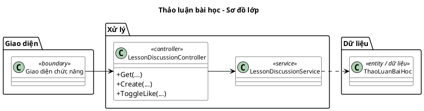

### Sơ đồ tuần tự chức năng hệ thống

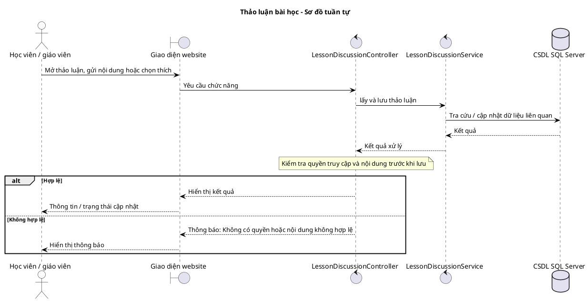

## 4.4.11. Làm bài kiểm tra và nhận chứng chỉ

### Sơ đồ lớp mức thiết kế

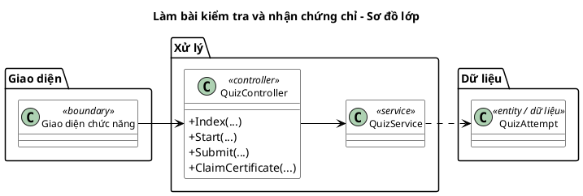

### Sơ đồ tuần tự chức năng hệ thống

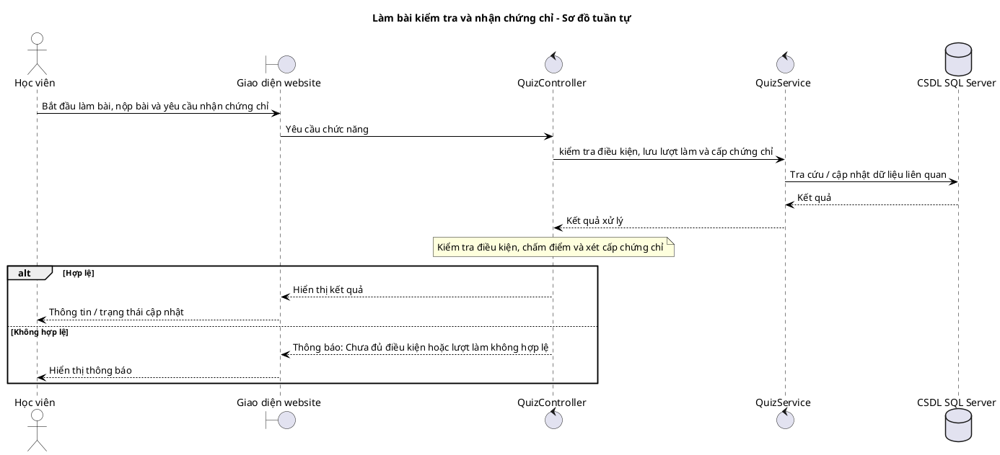

## 4.4.12. Đánh giá khóa học

### Sơ đồ lớp mức thiết kế

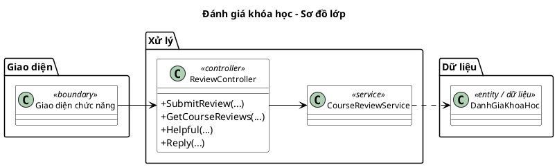

### Sơ đồ tuần tự chức năng hệ thống

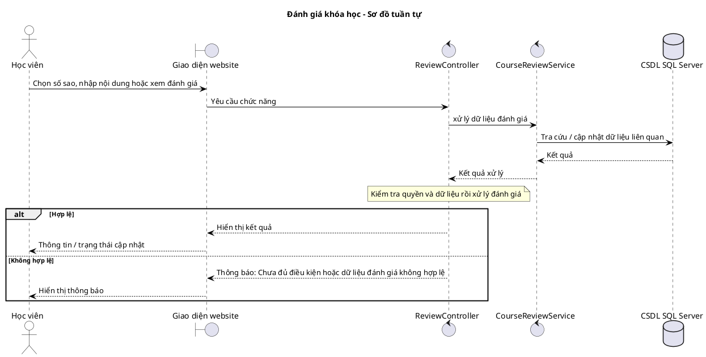

## 4.4.13. Giáo viên quản lý bài kiểm tra

### Sơ đồ lớp mức thiết kế

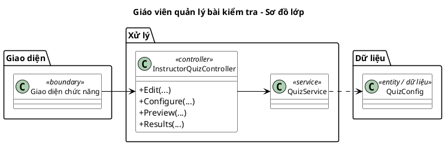

### Sơ đồ tuần tự chức năng hệ thống

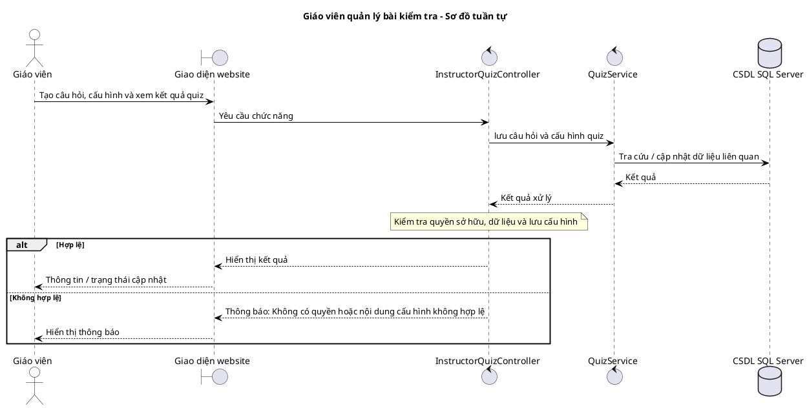

## 4.4.14. Giáo viên yêu cầu nhận doanh thu

### Sơ đồ lớp mức thiết kế

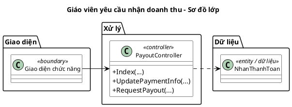

### Sơ đồ tuần tự chức năng hệ thống

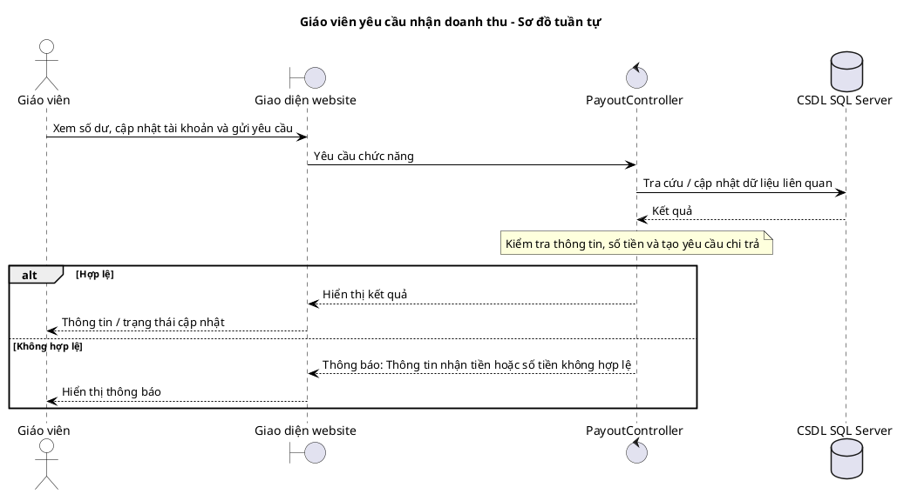

## 4.4.15. Quản trị viên xử lý yêu cầu chi trả

### Sơ đồ lớp mức thiết kế

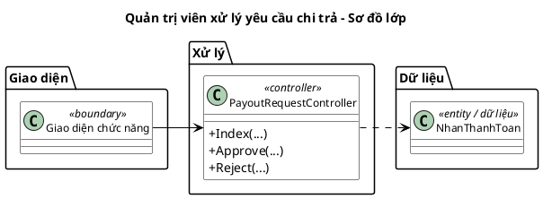

### Sơ đồ tuần tự chức năng hệ thống

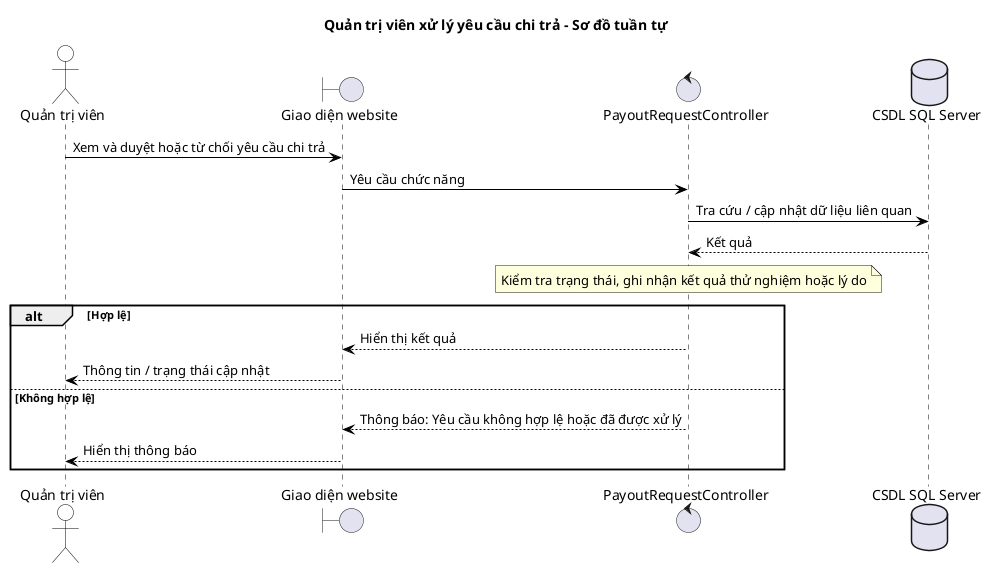

## 4.4.16. Duyệt đăng ký giáo viên

### Sơ đồ lớp mức thiết kế

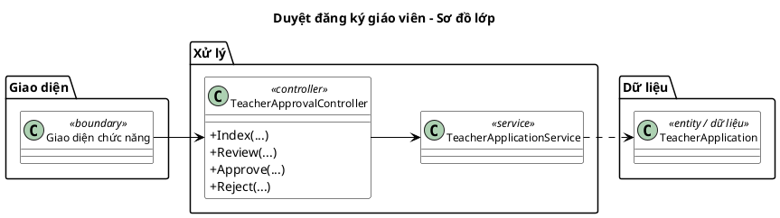

### Sơ đồ tuần tự chức năng hệ thống

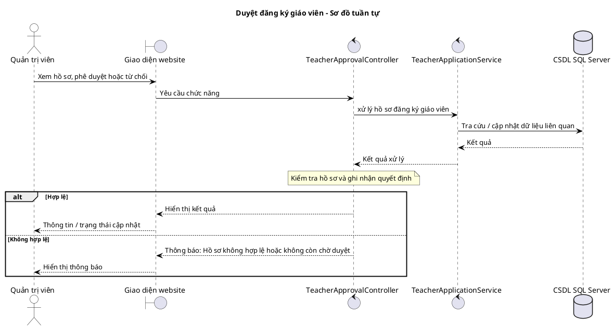

## 4.4.17. Quản lý người dùng

### Sơ đồ lớp mức thiết kế

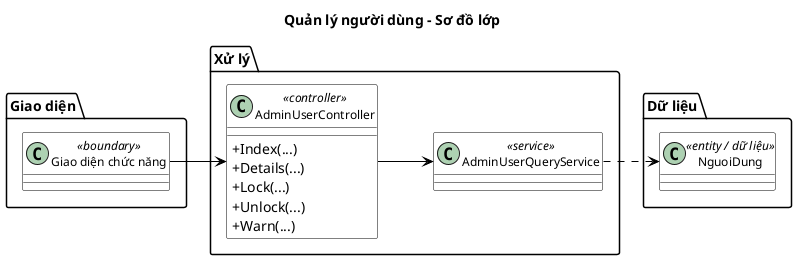

### Sơ đồ tuần tự chức năng hệ thống

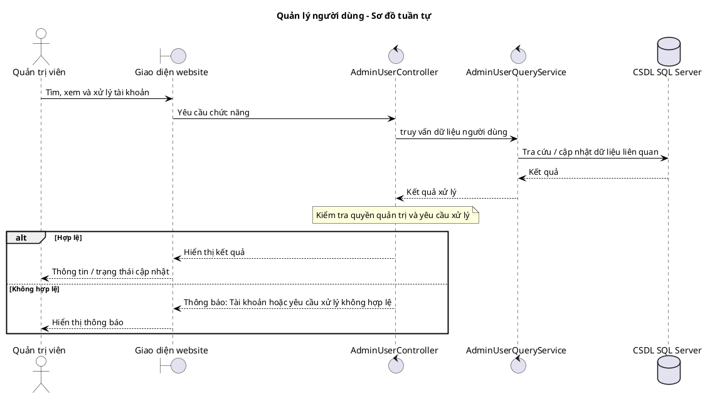

## 4.4.18. Quản lý danh mục khóa học

### Sơ đồ lớp mức thiết kế

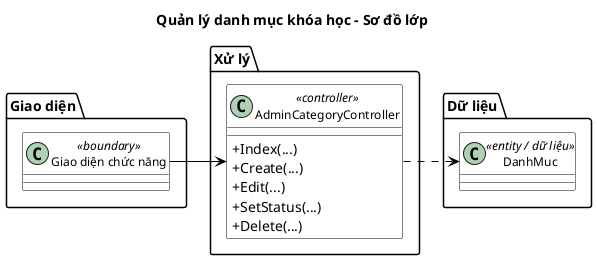

### Sơ đồ tuần tự chức năng hệ thống

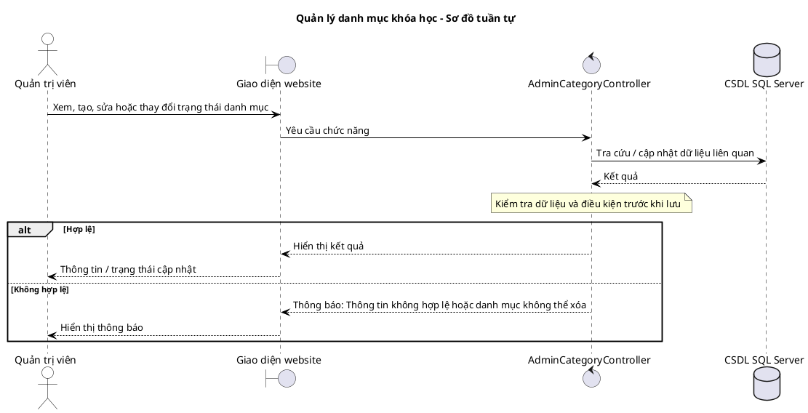
