# Mã PlantUML chương 4.4 — Phần 3

Gồm chức năng 4.4.19 đến 4.4.27; mỗi chức năng có một sơ đồ lớp và một sơ đồ tuần tự. Sao chép từng khối từ @startuml đến @enduml vào PlantUML. Các sơ đồ bổ sung là khung tổng quan và cần đối chiếu mã trước khi đưa vào báo cáo; tên giao diện trong sơ đồ là cách biểu diễn.

## 4.4.19. Xử lý báo cáo vi phạm

### Sơ đồ lớp mức thiết kế

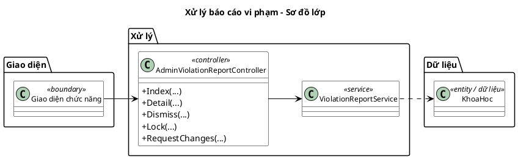

### Sơ đồ tuần tự chức năng hệ thống

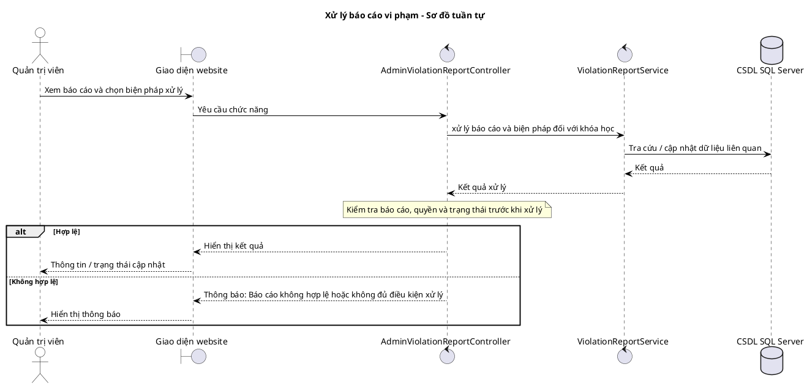

## 4.4.20. Quản lý chương trình khuyến mãi

### Sơ đồ lớp mức thiết kế

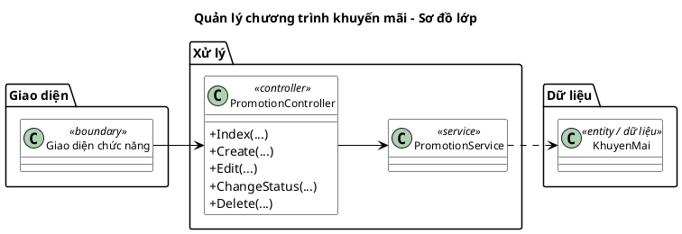

### Sơ đồ tuần tự chức năng hệ thống

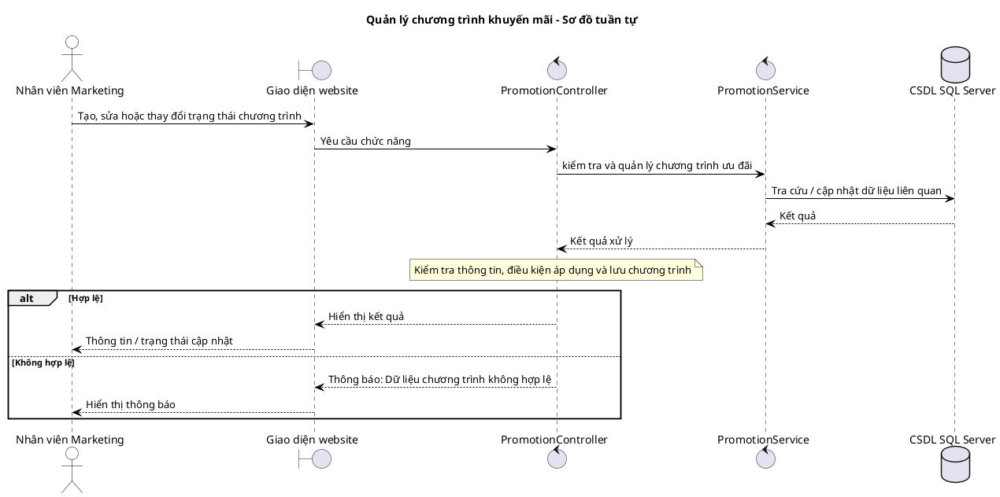

## 4.4.21. Quản lý chiến dịch Marketing

### Sơ đồ lớp mức thiết kế

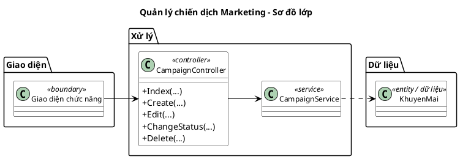

### Sơ đồ tuần tự chức năng hệ thống

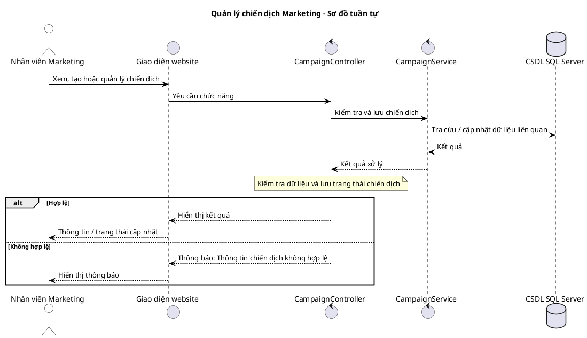

## 4.4.22. Báo cáo hiệu quả Marketing

### Sơ đồ lớp mức thiết kế

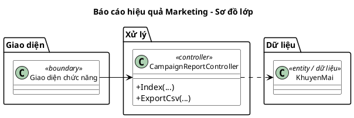

### Sơ đồ tuần tự chức năng hệ thống

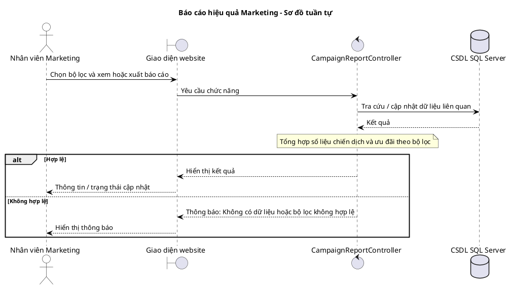

## 4.4.23. Đăng ký trở thành giáo viên

### Sơ đồ lớp mức thiết kế

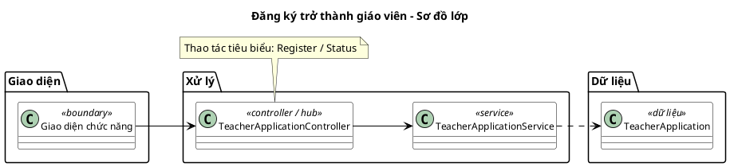

### Sơ đồ tuần tự chức năng hệ thống

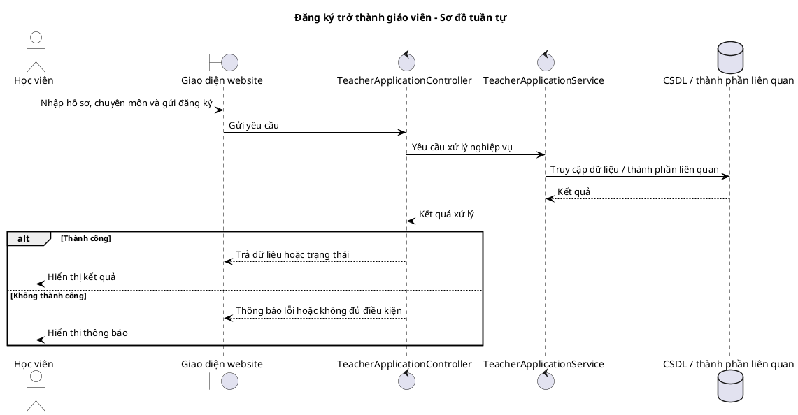

## 4.4.24. Tra cứu học viên của giáo viên

### Sơ đồ lớp mức thiết kế

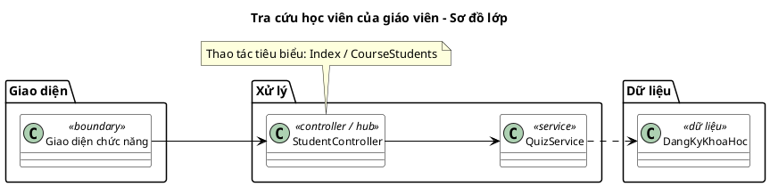

### Sơ đồ tuần tự chức năng hệ thống

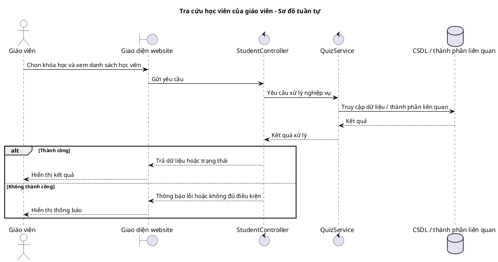

## 4.4.25. Báo cáo và thống kê hệ thống

### Sơ đồ lớp mức thiết kế

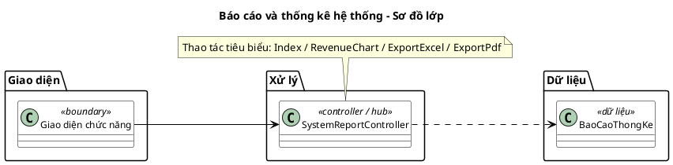

### Sơ đồ tuần tự chức năng hệ thống

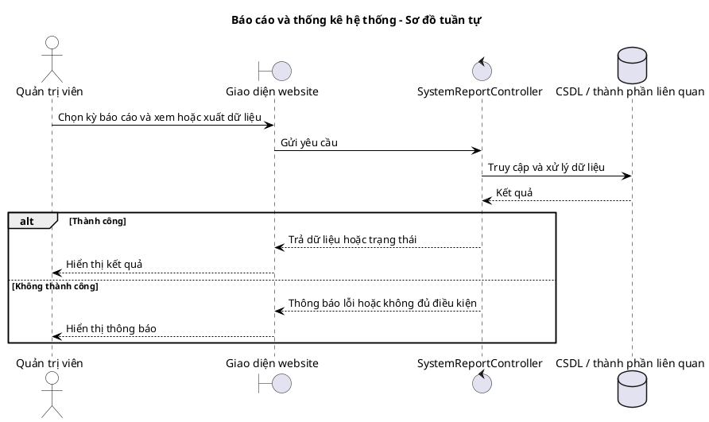

## 4.4.26. Hỗ trợ qua chatbot

### Sơ đồ lớp mức thiết kế

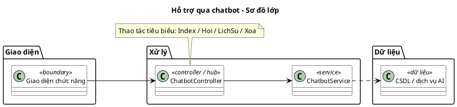

### Sơ đồ tuần tự chức năng hệ thống

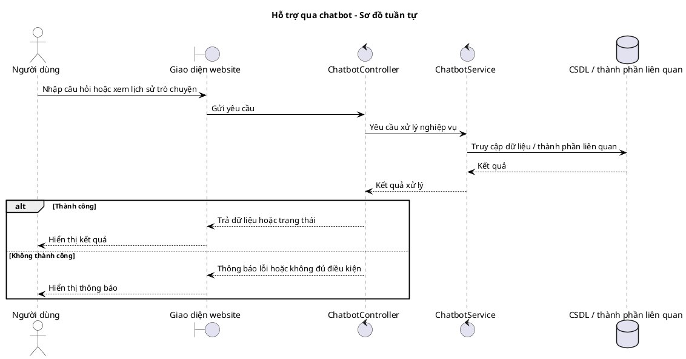

## 4.4.27. Nhắn tin học viên và giáo viên

### Sơ đồ lớp mức thiết kế

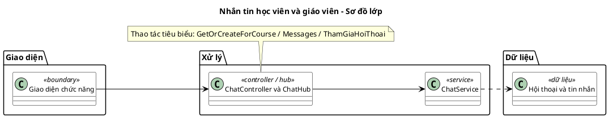

### Sơ đồ tuần tự chức năng hệ thống

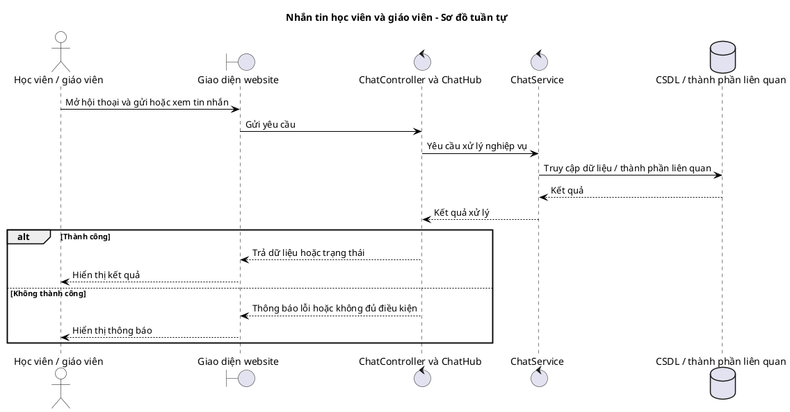
